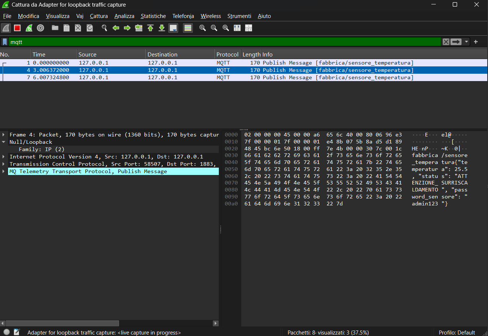
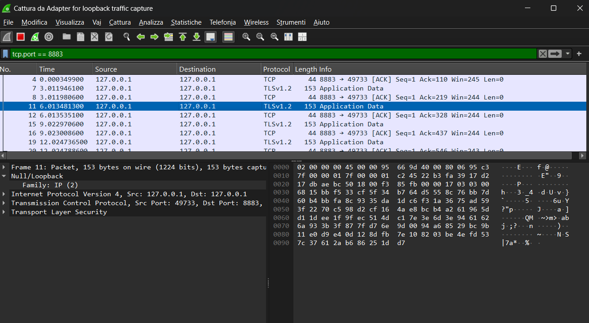

# Secure IoT MQTT Broker with mTLS

This project demonstrates a practical implementation of **Zero Trust Security** principles in an IoT/Edge Computing environment. It features a containerized **Mosquitto MQTT broker** secured with **Mutual TLS (mTLS)** to prevent eavesdropping and unauthorized access.

## Features
* **Dockerized Infrastructure**: MQTT broker isolated and deployed via Docker Compose.
* **Mutual TLS (mTLS) Authentication**: Bidirectional verification using custom CA, Server, and Client certificates.
* **Vulnerability Analysis**: Practical demonstration of plaintext MQTT vulnerabilities vs. TLS-encrypted traffic.
* **Python Edge Client**: Simulated IoT sensor publishing telemetry data using the **paho-mqtt** library.

## Security Analysis (Packet Capture)

### 1. The Vulnerability (Plaintext MQTT)
Without TLS, sensitive telemetry data and credentials are transmitted in plaintext and can be easily intercepted using tools like Wireshark.

### 2. The Solution (Encrypted mTLS)
By implementing mTLS on port **8883** and disabling anonymous access, the payload is securely encapsulated within TLSv1.2 Application Data, ensuring confidentiality and integrity.

## 🛠️ Tech Stack
* **Broker**: Eclipse Mosquitto
* **Infrastructure**: Docker & Docker Compose
* **Security**: OpenSSL (X.509 Certificates), TLSv1.2
* **Client**: Python 3, **paho-mqtt**
* **Analysis**: Wireshark